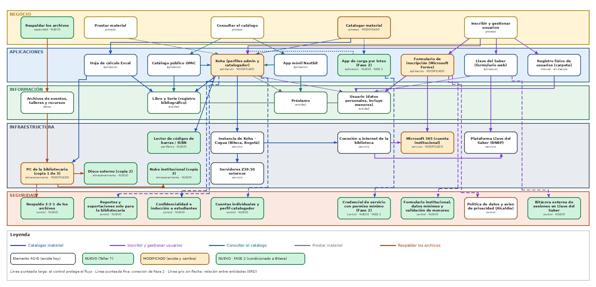

# 📄 Informe Técnico del Taller

## 🔖 Nombre del Taller
_Taller 8 - Integración de Vistas de Arquitectura (Parte 2: aplicación al cliente real)_

## 👥 Integrantes del equipo
- Jorge Alarcón (Jorgealis)
- Julián Aguirre (JulianAguirreUnisabana)
- Brayan Presiga (Brayan-137)

_(Equipo ARQUITECH)_

## 🧠 Descripción general del trabajo
El objetivo del taller es integrar en un solo tablero las vistas de arquitectura de la Biblioteca Pública Municipal de Cogua - Rubiel Valencia Cossio: negocio (Taller 1), información (Taller 2), aplicaciones (Taller 3), infraestructura (Taller 4) y seguridad (Talleres 5 y 6), más el TO-BE de Aplicaciones y Tecnología del Taller 7. La Parte 1 se trabajó en clase con el caso de FarmApp (`clase/tablero-farmapp.drawio`). Este informe documenta la **Parte 2**: el tablero del cliente real en `tablero-integrado-cliente.drawio`, que muestra a la vez el estado actual (AS-IS) y lo que propone el Taller 7 (NUEVO).

## 🔧 Proceso de desarrollo

#### Herramientas
- Draw.io para el tablero. Las 5 vistas se dibujaron como bandas horizontales, una debajo de otra, igual que en el tablero de clase.
- Los nombres de los elementos se copiaron de los entregables previos para que coincidan: el C2 del Taller 3, el mapa del Taller 4, el DFD del Taller 5, el checklist del Taller 6 y los `.drawio` TO-BE del Taller 7.
- Claude (asistente de IA) para proponer la distribución del tablero, redactar borradores del informe y buscar fuentes [7]. Los datos del cliente y las decisiones de los talleres previos los aportó el equipo; la IA no agregó hallazgos nuevos.

#### Proceso (los 5 pasos de la guía)
1. **Organizar las vistas en capas.** Se definieron las 5 capas del tablero: Negocio, Aplicaciones, Información, Infraestructura y Seguridad. Infraestructura tiene dos filas porque el Taller 4 separa lo que corre en el centro de datos de Biteca de lo que está en la biblioteca.
2. **Ubicar los elementos de cada vista.** Se transcribieron 34 elementos, sin conectar: 5 procesos o capacidades de negocio, 8 aplicaciones, 4 entidades o conjuntos de datos, 9 piezas de infraestructura y 8 controles de seguridad. Los del Taller 7 se marcaron como **NUEVO**, los que existen y cambian como **MODIFICADO**, y la Fase 2 con borde punteado.
3. **Trazar las relaciones verticales, un hilo a la vez.** Se trazaron 5 hilos de negocio, cada uno con su color: Catalogar material, Inscribir y gestionar usuarios, Consultar el catálogo, Prestar material y Respaldar los archivos. El de catalogación es el principal porque es la brecha raíz del Taller 7 (G1).
4. **Redactar la narrativa.** Ver la sección "Narrativa de coherencia".
5. **Revisar que no queden huérfanos.** Se verificó con una tabla (más abajo) que cada elemento tenga al menos una conexión. El resultado fue de 0 huérfanos sobre 34 elementos, pero la revisión sí dejó hallazgos (ver "Reflexión crítica").

## 🧩 Análisis del modelo propuesto

### Cómo se estructura el modelo
- **Negocio.** Se tomaron los procesos y capacidades del cliente: catalogar (BPMN del Taller 1), inscribir usuarios, prestar material, consultar el catálogo y respaldar archivos. Cuatro existen hoy y una es nueva. *Catalogar material* se marca como modificada porque en el TO-BE la ejecutan los estudiantes catalogadores y la bibliotecaria revisa una muestra; *Respaldar los archivos* es la capacidad nueva (WP1).
- **Aplicaciones.** Koha (con los perfiles administrador y catalogador), el catálogo público OPAC, la app Nextbit, el formulario de Microsoft Forms, Llave del Saber, el Excel de la colección sin catalogar y el registro físico en carpeta, que está en desuso. En el TO-BE se suma la app de carga por lotes (Fase 2).
- **Información.** Libro y Serie, Usuario y Préstamo (el ERD del Taller 2) y los archivos de eventos, talleres y recursos (el dato que protege el respaldo).
- **Infraestructura.** La instancia de Koha en el centro de datos de Biteca, la plataforma de Llave del Saber (RNBP), los servidores Z39.50 externos, la conexión a internet, Microsoft 365, y el PC de la bibliotecaria. Lo nuevo es el lector de códigos, el disco externo y la nube institucional (copias 2 y 3 del respaldo).
- **Seguridad.** Se muestra como controles que protegen flujos concretos y no como un anexo: ocho controles, uno AS-IS (la política de datos y el aviso de privacidad de la Alcaldía) y siete que vienen de las mitigaciones del Taller 5 y las recomendaciones del Taller 6, tal como las integró el Taller 7.

### Cómo representa las necesidades del cliente
- **El cuello de botella es visible.** En el hilo de Catalogar se ve que la carga del catálogo pasa por un solo proceso y que hoy el 90 % de la colección vive en el Excel (Taller 6, ítem 15). Por eso Excel y Koha apuntan a la misma entidad, Libro.
- **Se corrige una lectura equivocada del Taller 3 original.** El C2 inicial afirmaba que el usuario no tenía canal digital. El tablero muestra el hilo *Consultar el catálogo* con el OPAC y la app Nextbit, que sí existen y solo exhiben cerca del 10 % de la colección. El problema es el contenido y no el canal.
- **La solución del Taller 7 se ve de punta a punta.** La catalogación distribuida (WP3) aparece conectada con sus tres controles: cuentas individuales, reportes solo para la bibliotecaria y confidencialidad con inducción. Así se ve que esa solución no solo reparte el trabajo, también cierra las brechas T3, T4 y T6 del Taller 5.
- **Las restricciones del cliente se respetan.** Ninguna conexión migra datos desde Llave del Saber hacia Koha (restricción legal de la ficha).

### Narrativa de coherencia

**Catalogar material (azul).** La bibliotecaria hoy digita título por título en Koha, busca registros en servidores Z39.50 externos y completa campos obligatorios; el resto de la colección está en el Excel de su PC. Koha corre en la instancia que Biteca opera en Bogotá, y toda la sesión de trabajo depende de la conexión única a internet de la biblioteca (Taller 4). En el TO-BE el proceso lo ejecutan los estudiantes catalogadores con el lector de códigos, que escribe el ISBN directamente en Koha. Esto se decidió con la matriz del Taller 7: la opción B (catalogación distribuida) obtuvo 4,20 frente a 3,45 de la asistida y 3,25 de la carga por lotes, porque reparte la carga, es de bajo costo y no depende de terceros. La carga por lotes quedó como Fase 2, condicionada a que Biteca habilite la API de Koha. Los tres controles de seguridad se anclan en Koha porque es donde se tocan los datos personales de menores: cuentas individuales y perfil catalogador, reportes restringidos a la bibliotecaria, y confidencialidad con inducción.

**Inscribir y gestionar usuarios (violeta).** Cada usuario nuevo se inscribe en el formulario de Microsoft Forms y la bibliotecaria lo registra después a mano en Koha y en Llave del Saber, por lo que los mismos datos personales (incluidos los de menores) terminan en tres almacenes distintos. Este es el hilo más expuesto: el formulario hoy está en una cuenta creada por un estudiante, fuera del control de la Alcaldía; Llave del Saber usa una credencial única por biblioteca; y la carpeta física no tiene candado (Taller 6, ítem 10). El TO-BE solo cubre parte de esto (formulario en cuenta institucional con datos mínimos, bitácora externa en Llave del Saber); el doble registro (G5) y la credencial única (G6) quedan en el backlog del WP5 porque dependen de la RNBP y de Biteca.

**Consultar el catálogo (turquesa).** El usuario consulta por el OPAC (`cogua.bibliotecasidecut.com`) o por la app Nextbit, y ambos leen de la misma instancia de Koha; Nextbit además permite reservar y renovar préstamos. Este hilo mejora solo por arrastre: cuando los estudiantes carguen más títulos, el catálogo público muestra más del 10 % actual (Ley 1379 de 2010 [6]). La seguridad de este hilo depende de Biteca y no tiene control propio en el TO-BE (ver reflexión crítica).

**Prestar material (gris).** Es el hilo con menos cambios: el préstamo se registra en Koha y relaciona un Libro con un Usuario (el ERD del Taller 2). Se incluyó para que el tablero no omitiera un proceso del cliente que el TO-BE no toca (madurez 3 → 3 en el Taller 7).

**Respaldar los archivos (naranja).** Los archivos de eventos, talleres y recursos existen en una sola copia en el PC de la bibliotecaria, el riesgo de mayor severidad del Taller 4. El TO-BE agrega el disco externo (otro medio) y la nube institucional (fuera del sitio) para cumplir el 3-2-1 [4][5]. Es el único hilo que la biblioteca puede cerrar sola, y por eso es un quick win.

## 📈 Diagrama final entregado

- [`tablero-integrado-cliente.drawio`](tablero-integrado-cliente.drawio): tablero de 5 capas con AS-IS y TO-BE del Taller 7 (editable en draw.io).

Convenciones: blanco = AS-IS, verde = NUEVO, ámbar = MODIFICADO, verde con borde punteado = Fase 2 condicionada a Biteca. La línea punteada larga indica que un control protege el flujo, la punteada fina una conexión de Fase 2, y la línea gris sin flecha una relación entre entidades del ERD.

## 📋 Tabla de actores, entidades o componentes

Verificación de elementos huérfanos (Paso 5 de la guía). "Hacia arriba" son las conexiones con la capa de arriba y "hacia abajo" las de la capa de abajo; en información no se trazó la relación con infraestructura (se da a través de las aplicaciones). La conexión a internet, el disco externo y la nube institucional no tienen conexión hacia arriba directa: se relacionan con elementos de su misma capa (a las aplicaciones llegan a través de la instancia de Koha, Microsoft 365, Llave del Saber y el PC).

| Nombre del elemento | Capa | Estado | Hacia arriba | Hacia abajo |
|---|---|---|---|---|
| Respaldar los archivos | Negocio | NUEVO | — (capa más alta) | Archivos de eventos, talleres y recursos |
| Prestar material | Negocio | AS-IS | — (capa más alta) | Koha (perfiles admin y catalogador) |
| Consultar el catálogo | Negocio | AS-IS | — (capa más alta) | App móvil Nextbit, Catálogo público OPAC |
| Catalogar material | Negocio | MODIFICADO | — (capa más alta) | Hoja de cálculo Excel, Koha (perfiles admin y catalogador), App de carga por lotes (Fase 2) |
| Inscribir y gestionar usuarios | Negocio | AS-IS | — (capa más alta) | Registro físico de usuarios (carpeta), Formulario de inscripción (Microsoft Forms), Koha (perfiles admin y catalogador), Llave del Saber (formulario web) |
| Hoja de cálculo Excel | Aplicaciones | AS-IS | Catalogar material | Libro y Serie (registro bibliográfico), PC de la bibliotecaria (copia 1 de 3) |
| Catálogo público OPAC | Aplicaciones | AS-IS | Consultar el catálogo | Libro y Serie (registro bibliográfico); mismo nivel: Koha (perfiles admin y catalogador) |
| Koha (perfiles admin y catalogador) | Aplicaciones | MODIFICADO | Catalogar material, Inscribir y gestionar usuarios, Prestar material | Instancia de Koha - Cogua (Biteca, Bogotá), Lector de códigos de barras / ISBN, Libro y Serie (registro bibliográfico), Préstamo, Cuentas individuales y perfil catalogador, Confidencialidad e inducción a estudiantes, Reportes y exportaciones solo para la bibliotecaria, Usuario (datos personales, incluye menores); mismo nivel: App de carga por lotes (Fase 2), App móvil Nextbit, Catálogo público OPAC |
| App móvil Nextbit | Aplicaciones | AS-IS | Consultar el catálogo | Préstamo; mismo nivel: Koha (perfiles admin y catalogador) |
| App de carga por lotes (Fase 2) | Aplicaciones | NUEVO (Fase 2) | Catalogar material | Credencial de servicio con permiso mínimo (Fase 2); mismo nivel: Koha (perfiles admin y catalogador) |
| Formulario de inscripción (Microsoft Forms) | Aplicaciones | MODIFICADO | Inscribir y gestionar usuarios | Microsoft 365 (cuenta institucional), Política de datos y aviso de privacidad (Alcaldía), Formulario institucional, datos mínimos y validación de menores, Usuario (datos personales, incluye menores) |
| Llave del Saber (formulario web) | Aplicaciones | AS-IS | Inscribir y gestionar usuarios | Plataforma Llave del Saber (RNBP), Bitácora externa de sesiones en Llave del Saber, Usuario (datos personales, incluye menores) |
| Registro físico de usuarios (carpeta) | Aplicaciones | AS-IS | Inscribir y gestionar usuarios | Usuario (datos personales, incluye menores) |
| Archivos de eventos, talleres y recursos | Información | AS-IS | Respaldar los archivos | PC de la bibliotecaria (copia 1 de 3) |
| Libro y Serie (registro bibliográfico) | Información | AS-IS | Hoja de cálculo Excel, Koha (perfiles admin y catalogador), Catálogo público OPAC | —; mismo nivel: Préstamo |
| Préstamo | Información | AS-IS | Koha (perfiles admin y catalogador), App móvil Nextbit | —; mismo nivel: Libro y Serie (registro bibliográfico), Usuario (datos personales, incluye menores) |
| Usuario (datos personales, incluye menores) | Información | AS-IS | Registro físico de usuarios (carpeta), Formulario de inscripción (Microsoft Forms), Koha (perfiles admin y catalogador), Llave del Saber (formulario web) | —; mismo nivel: Préstamo |
| Lector de códigos de barras / ISBN | Infraestructura | NUEVO | Koha (perfiles admin y catalogador) | — |
| Instancia de Koha - Cogua (Biteca, Bogotá) | Infraestructura | AS-IS | Koha (perfiles admin y catalogador) | Servidores Z39.50 externos; mismo nivel: Conexión a internet de la biblioteca |
| Conexión a internet de la biblioteca | Infraestructura | AS-IS | — | —; mismo nivel: Instancia de Koha - Cogua (Biteca, Bogotá), Microsoft 365 (cuenta institucional), Plataforma Llave del Saber (RNBP) |
| Microsoft 365 (cuenta institucional) | Infraestructura | MODIFICADO | Formulario de inscripción (Microsoft Forms) | —; mismo nivel: Conexión a internet de la biblioteca |
| Plataforma Llave del Saber (RNBP) | Infraestructura | AS-IS | Llave del Saber (formulario web) | —; mismo nivel: Conexión a internet de la biblioteca |
| PC de la bibliotecaria (copia 1 de 3) | Infraestructura | MODIFICADO | Archivos de eventos, talleres y recursos, Hoja de cálculo Excel | Respaldo 3-2-1 de los archivos; mismo nivel: Disco externo (copia 2), Nube institucional (copia 3) |
| Disco externo (copia 2) | Infraestructura | NUEVO | — | —; mismo nivel: PC de la bibliotecaria (copia 1 de 3) |
| Nube institucional (copia 3) | Infraestructura | NUEVO | — | —; mismo nivel: PC de la bibliotecaria (copia 1 de 3) |
| Servidores Z39.50 externos | Infraestructura | AS-IS | Instancia de Koha - Cogua (Biteca, Bogotá) | — |
| Respaldo 3-2-1 de los archivos | Seguridad | NUEVO | PC de la bibliotecaria (copia 1 de 3) | — (capa más baja) |
| Reportes y exportaciones solo para la bibliotecaria | Seguridad | NUEVO | Koha (perfiles admin y catalogador) | — (capa más baja) |
| Confidencialidad e inducción a estudiantes | Seguridad | NUEVO | Koha (perfiles admin y catalogador) | — (capa más baja) |
| Cuentas individuales y perfil catalogador | Seguridad | NUEVO | Koha (perfiles admin y catalogador) | — (capa más baja) |
| Credencial de servicio con permiso mínimo (Fase 2) | Seguridad | NUEVO (Fase 2) | App de carga por lotes (Fase 2) | — (capa más baja) |
| Formulario institucional, datos mínimos y validación de menores | Seguridad | NUEVO | Formulario de inscripción (Microsoft Forms) | — (capa más baja) |
| Política de datos y aviso de privacidad (Alcaldía) | Seguridad | AS-IS | Formulario de inscripción (Microsoft Forms) | — (capa más baja) |
| Bitácora externa de sesiones en Llave del Saber | Seguridad | NUEVO | Llave del Saber (formulario web) | — (capa más baja) |

## 🪞 Reflexión crítica sobre la coherencia de la arquitectura

**Lo que quedó coherente.** Ningún elemento de los Talleres 1 a 7 quedó fuera del tablero, y los nombres coinciden con los entregables previos (por ejemplo, Bibliotecaria y no un nombre personal, Biteca como operador de Koha). Cada hilo de negocio llega hasta infraestructura y toca al menos un control de seguridad, salvo los casos que se listan abajo.

**Hallazgos que dejó la integración** (cosas que no se veían mirando cada taller por separado):
1. **Consultar el catálogo no tiene control de seguridad propio.** El OPAC y Nextbit exponen Koha a internet (T6 del Taller 5 se recalculó como riesgo alto), pero el TO-BE no agrega ningún control ahí; todo depende de la evidencia que entregue Biteca (G8, backlog). Es la mayor asimetría del tablero: el tablero tiene siete controles nuevos, tres de ellos anclados a Koha, y ninguno en el canal público.
2. **La continuidad cuando falla internet (G7) no tiene solución en el TO-BE.** La conexión única es el nodo del que dependen los hilos de Catalogar e Inscribir (aparece conectada a la instancia de Koha, Microsoft 365 y Llave del Saber), pero la mejora queda en el backlog.
3. **Dos brechas quedan sin cerrar y se ven como flechas sin control:** el doble registro (G5) y la credencial única de Llave del Saber (G6), ambas dependientes de terceros. Lo único que cubre el TO-BE ahí es una bitácora externa, que mitiga pero no resuelve.
4. **El registro físico en carpeta sigue en el tablero** porque es AS-IS y contiene datos de usuarios, pero está en desuso; no se le asignó un control del TO-BE porque el Taller 7 no lo trata (Taller 6, ítem 10, queda pendiente).
5. **El mapa de infraestructura del Taller 4 no dibuja el Excel como componente aparte** (vive en el almacenamiento local del PC). En el tablero se separó en la capa de Aplicaciones y se conectó al PC, para que se vea que ahí vive el 90 % de la colección.

**Decisiones clave:** (a) presentar la seguridad como controles conectados a cada flujo y no como un anexo; (b) tratar la catalogación como brecha raíz, de acuerdo con la matriz del Taller 7; (c) mostrar la Fase 2 en el tablero pero marcada como condicionada, para no comprometer a Biteca con algo que no ha confirmado; (d) incluir los procesos que el TO-BE no toca (Prestar, Consultar), para no dar la impresión de que el trabajo previo se descartó.

**Supuestos y límites:**
- Los controles NUEVO del tablero son los del Taller 7. Los supuestos de ese taller (horas de los estudiantes, perfil restringido sin probar, API de Koha sin confirmar, costos por cotizar) siguen vigentes.
- Las conexiones se trazaron a nivel lógico (qué aplicación usa qué dato y en qué infraestructura corre). No se probaron configuraciones reales: no se tuvo acceso administrativo a Koha ni a Llave del Saber.
- Para que el tablero sea consistente, el mapa del Taller 4 debe incluir la zona "Biblioteca de Cogua", el PC, Excel y la carpeta (pendiente de la retroalimentación de ese taller).

## 🔍 Investigación complementaria

### Tema investigado: cómo se documentan las vistas de una arquitectura y se mantienen consistentes entre sí

Buscamos cómo lo hacen en la práctica organizaciones parecidas a la biblioteca (instituciones públicas o educativas con recursos limitados) y qué dice la norma. Según Emery y Hilliard, la norma ISO/IEC/IEEE 42010 define una descripción de arquitectura como un conjunto de **vistas**, cada una basada en un **punto de vista** que fija qué preocupaciones y qué interesados atiende. explican que el punto de vista actúa como la leyenda de un mapa, y que la revisión de la norma que ellos discuten (era un borrador en 2009) introduce las **correspondencias entre modelos** para expresar relaciones de consistencia o trazabilidad entre dos o más vistas, que pueden ser relaciones, tablas o gráficos [1]. Esa idea es lo que hace nuestra tabla de huérfanos: una correspondencia explícita entre cada elemento y la capa de arriba y de abajo.

ArchiMate, el lenguaje que el curso usa como referencia, formaliza esas conexiones entre capas: las aplicaciones *sirven* a los procesos de negocio (relación de servicio) y un objeto de datos puede *realizar* un objeto de negocio; además, las relaciones entre capas lejanas pueden derivarse a partir de las intermedias [2]. En nuestro tablero, esto justifica que *Inscribir y gestionar usuarios* se conecte con el Formulario y con Koha (servicio) y que la entidad *Usuario* se conecte con las tres aplicaciones que la guardan.

El caso más cercano que encontramos es el informe de la Universidad de Coventry, que modeló sus capas de negocio, aplicaciones y tecnología con ArchiMate en el proyecto de arquitectura empresarial de JISC [3]. Trabajaron de arriba hacia abajo (primero los procesos de negocio y luego las aplicaciones e infraestructura que los soportan), igual que nuestros hilos. Su lección principal nos cambió una decisión: los interesados de negocio encontraron más útiles las vistas simplificadas y los modelos de procesos que los diagramas completos de ArchiMate, y las personas de TI sí usaron los modelos para evaluar impacto y alcance. Por eso el tablero tiene un hilo por proceso de negocio, con colores, y un informe narrativo que explica las decisiones, para que la bibliotecaria pueda leer un solo hilo sin tener que entender las 34 piezas. Su otra lección fue que adaptar el lenguaje es necesario para no diluir los modelos [3]; en nuestro caso adaptamos la notación con colores de estado (AS-IS, NUEVO, MODIFICADO) en lugar de la simbología completa de ArchiMate.

## 📚 Referencias
Ver [`referencias.md`](referencias.md).

---

_Este documento hace parte de la entrega del Taller 8 (Integración de Vistas) del curso AREM (Arquitectura Empresarial) - Universidad de La Sabana._
